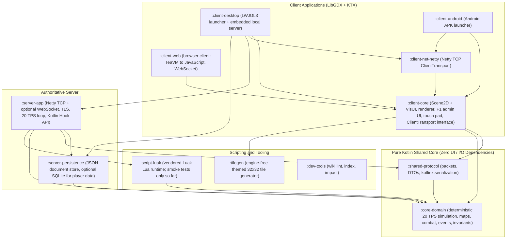

# Morgana ORPG — System Architecture

## High-Level Module Graph

`:dev-tools` and `:tilegen` depend on no other project module. `:script-luak` implements the `:core-domain` scripting port using the vendored Luak runtime. The desktop client depends on the server modules so it can host a world in-process.

---

## Gradle Multi-Module Layout

| Module | Responsibility | Allowed Dependencies |
| :--- | :--- | :--- |
| `:core-domain` | Pure Kotlin domain models, the deterministic 20 TPS `WorldSimulation` (facade plus the kernel services `MovementSystem`, `CombatSystem`, `NpcAiSystem`, `InventorySystem`, `EconomySystem`, `EventSystem`, `AdminSystem`, and the optional systems in `systems/` installed through the kernel seams), hybrid movement (grid and pixel), tile attributes, data-defined attributes, vitals and combat formulas evaluated via `GameDefinition` and `CompiledGame` (`MorganaClassic`), pure `ScriptRuntime` port (`ScriptBudget`, `ScriptEffect`, `ScriptWorldView`, `ScriptRegistry`), status effects, the page-based event evaluator, 5-tier access rules, content validation (`ContentValidator`), deterministic replay (`SimInput`, `StateHasher`) and optional-module flags. | Kotlin stdlib, `kotlinx.serialization-core` (data models and annotations only). **Zero LibGDX, Netty, or filesystem I/O dependencies.** |
| `:shared-protocol` | Client-server packet definitions (`ClientPacket`, `ServerPacket`), snapshot and delta packets, live `F1` editor payloads (`c_admin_save_*`), the `PROTOCOL_VERSION` handshake, the JSON packet codec (a CBOR codec exists but the wire format is JSON), and the TLS identity helpers (invite codes, fingerprints). | `:core-domain`, `kotlinx.serialization-json`, `kotlinx.serialization-cbor`, JDK security APIs. |
| `:server-persistence` | Repositories (`WorldContentRepository`, `AccountRepository`, `CharacterRepository`, `SocialMarketRepository` for guilds, mail and market documents) behind a `DocumentCollection` port, assembled by `MorganaDataStore`. Implementations: `JsonFileDocumentCollection` (default, files under `world/`, `accounts/`, `characters/`), opt-in `SqliteDocumentCollection` for player data (`storage.playerData` in `server.json`) and the zero-I/O `InMemoryDocumentCollection`. Also `ContentLoader`, `ContentSchemaExporter`, `WorldPack`, `ReplayLogCodec`, `ServerConfig`, the Tiled converter (`TiledMapConverter`, both directions) and `GameScaffolder` (new game projects, and the blank seed for empty data directories). There is no MongoDB adapter. | `:core-domain`, `kotlinx.serialization-json`, `org.xerial:sqlite-jdbc`. |
| `:server-app` | Dedicated authoritative server process. Runs the Netty TCP transport (4-byte length-prefixed JSON frames, optionally inside TLS, behind per-address connection limits and per-packet flood limits) and an optional WebSocket listener for browsers (`MORGANA_WS_PORT`), the 20 TPS (50 ms) game loop, owner policy, the admin command processor, the live `F1` content pipeline with file-watch hot reload, the Kotlin Hook API, and Lua script host coordination. `MorganaServerRuntime` assembles it for both the dedicated server and the desktop client's embedded server. | `:core-domain`, `:shared-protocol`, `:server-persistence`, `:script-luak`, Netty, BouncyCastle, kotlinx.coroutines, SLF4J/Logback. |
| `:client-core` | Platform-independent LibGDX + KTX client. Implements the 6-layer map renderer, seamless N/S/E/W map stitching, autotiles, dynamic 2D lighting and weather, paperdoll sprite renderer, the procedural PCM audio engine (`RetroSoundEngine`, loaded through a per-platform `SoundLoader`), the 10-slot action hotbar (`1..0`), the minimap radar, the Scene2D player HUD, and the VisUI `F1` Live Admin Editors. It talks to the server only through the `ClientTransport` interface; it contains no networking library. | `:core-domain`, `:shared-protocol`, `:tilegen`, LibGDX (`gdx`), LibKTX, VisUI, kotlinx.coroutines. |
| `:game-art` | Per-game art kits and exporters for the bundled games, built on `:tilegen`. Tooling only: no engine module depends on it. | `:tilegen`. |
| `:tilegen` | Pixel-art generator: themed map tiles (`ProceduralTilesetGenerator`, `ThemedTilesetGenerator`), autotiles, props and structures, paper-doll characters and monsters, JSON tileset specs, PNG export and a CLI (`:tilegen:run`), drawing into a plain RGBA8888 `TileImage`. `:client-core` converts to `Pixmap` (`TileImagePixmaps.kt`) for the default tileset; `:client-desktop:generateTileset` exports PNGs. | Kotlin stdlib only. **No LibGDX.** |
| `:client-net-netty` | The Netty TCP `ClientTransport` (`MorganaNetClient`), including TLS with certificate fingerprint pinning. Shared by the desktop and Android launchers. | `:client-core`, Netty. |
| `:client-desktop` | LWJGL3 desktop entry point, window configuration, the local world picker with **New World & Play**, and an in-process server (`EmbeddedWorldHost`) for local play. | `:client-core`, `:client-net-netty`, `:server-app`, `:server-persistence`, `gdx-backend-lwjgl3`, `gdx-platform:natives-desktop`. |
| `:client-android` | Android APK entry point (`AndroidLauncher`), LibGDX native `.so` extraction (`armeabi-v7a`, `arm64-v8a`, `x86`, `x86_64`), sensor-landscape immersive layout and on-screen touch controls. | `:client-core`, `:client-net-netty`, `gdx-backend-android`, `gdx-platform:natives-*`. |
| `:client-web` | Browser client: `:client-core` compiled to JavaScript by gdx-teavm (TeaVM), with `BrowserWebSocketTransport` (WebSocket frames), `BrowserSoundLoader` (Howler) and a reflection policy for the VisUI skin. Needs the server's WebSocket port. | `:client-core`, TeaVM JSO APIs, the gdx-teavm Gradle plugin. |
| `:script-luak` | Home of the Lua scripting runtime: Luak, vendored and checksum-pinned in `third-party/`. Implements the pure `:core-domain` `ScriptRuntime` port (`LuakScriptRuntime`, `LuakSandbox`, `LuakScriptValidator`). The only module allowed to depend on Luak. | `:core-domain`, Luak (`luak-core-jvm`), SLF4J. |
| `:dev-tools` | Repository tooling: OKF wiki lint (`wikiLint`, part of `check`), index generation and change-impact lookup. | `snakeyaml` only; no project modules. |

---

## Layers: Core, Systems, Templates and Plugins

The engine is four layers ([ADR 0018](../wiki/decisions/0018_core_systems_plugins_templates_terminology.md); the details are in `wiki/systems/system_seams.md`):

| Layer | What it is | Where it lives |
| :--- | :--- | :--- |
| **Core** | The base engine every game needs: the deterministic simulation kernel (movement, combat, inventory, NPC AI, events, map copies), persistence, networking, permissions, replay, the content pipeline, the clients and the `F1` editors. | `:core-domain` `sim/` and the other modules |
| **Systems** | Optional features, one object each, reaching the kernel only through twelve seam interfaces (`RequirementGate`, `EventCommandHandler`, `TickParticipant`, `CombatArbiter`, `CombatObserver`, `ActionGate`, `ActivityInterrupter`, `ChatCommandHandler`, `ItemUseHandler`, `KillObserver`, `MonsterBehavior`, `WarpRouter`). Each has a key in the one system list (`OptionalModule`), genre tags and requirements. Genres are tags, not layers. | `:core-domain` `systems/`, registered by `WorldSimulation.install` |
| **Templates** | Starting games that declare which systems are on. A genre starter switches on the systems tagged for a genre and off the rest. | `games/<name>/`, `world-new --genre`, the New Realm Wizard |
| **Plugins** | Sandboxed Lua in a game's `scripts/` that adds to or replaces systems: `register.plugin{ requires, replaces }` plus one registration per seam. Trusted Kotlin jars in `plugins/` are *add-on systems* at the server layer (hooks, windows, storage), not part of a template. | `games/<name>/scripts/`, `:script-luak`, `ScriptedSystem` |

Rules that keep the layers apart (enforced by `RequirementGateTest` and `SystemListTest`, part of `check`): nothing outside `systems/` imports it except `WorldSimulation` (the composition root); every installed system is a `GameSystem` whose key is an `OptionalModule`; every `OptionalModule` is an installed system or one of a short pinned list of switches the kernel checks itself. A system is on when its `server.json` switch is on and no running plugin replaces it. `core-domain` stays pure: seams run inside the deterministic simulation and Lua hooks are re-run on replay.

## Architectural Invariants & Boundary Rules

0. **Engine and game content are separate** (enforced by `EngineBoundaryTest` in `:dev-tools`, part of `check`):
   - A game is a folder under `games/` (`game.json`, `data/`, `scripts/`, `assets/`). No engine module may name a shipped game, build a `games/<name>` path outside the listed tooling files, or reference a content id.
   - The engine owns *mechanisms* (tick loop, movement, maps, schemas, validation, expression language, script port, combat-module interface, optional modules); a game owns *rules and content* (attributes, vitals, formulas, XP curve, combat numbers, UI profile, data, scripts, art).
   - The engine has one neutral default game, `BlankGame` (`:core-domain`), used for a data directory without `game.json`, as the blank template's rules, and as the client's placeholder before login. The old Morgana Classic ruleset is a `:core-domain` **test fixture** (`testFixtures`) used only by tests; no shipped code may use it.
   - `:core-domain` imports only itself, the Kotlin stdlib, `kotlinx.serialization` and `java.math`, and never touches the clock or the file system.

1. **Pure Deterministic `:core-domain`**:
   - Never call wall-clock APIs (`System.currentTimeMillis()`, `Instant.now()`), `Math.random()` or unseeded random sources, or perform disk/network I/O inside `:core-domain`.
   - Time advances only through `WorldSimulation.stepTick(deltaMs)` (`50 ms` at 20 TPS); the simulation owns `currentTick` and a seeded `RandomSource`. Externally driven calls (moves, attacks, casts, item use, shop, trade, admin commands, ticks) are `SimInput`s that can be recorded, so the same seed plus the same input log reproduces the same world. Party and guild actions and live content edits are not replayable yet and mark a recording with gaps.
2. **Authoritative Server + Client Prediction**:
   - `:server-app` and `:client-core` share the `:core-domain` movement and collision rules so the client can predict local player movement smoothly while the server remains authoritative over position, vitals, inventory, combat, rate limits and `F1` admin edits.
   - Movement steps are numbered (`MoveInput.seq`) and the server's own-character sync says which it includes (`CharacterSync.ackMoveSeq`); the client replays the unacknowledged steps on top of each sync, so latency does not pull the player back. Steps the network delivers bunched wait in a per-session `MoveInputQueue` for later ticks instead of being dropped by the rate limit.
3. **Document-Oriented Persistence (JSON today, behind a port)**:
   - Persistence goes through the `DocumentCollection` port. World content is one JSON file per definition (`MapDefinition`, `ItemDefinition`, `NpcDefinition`, `SpellDefinition`, `ShopDefinition`, `ResourceDefinition`, `RecipeDefinition`, `QuestDefinition`, `EventDefinition`, `AnimationDefinition`, `ClassDefinition`); player data is `AccountDocument`, `CharacterState`, `GuildDocument` and mail/market documents.
   - Content definitions and documents carry a `schemaVersion: Int` and a stable `id` (an `Int` slot id for content, a `String` for accounts and characters), so a different `DocumentCollection` backend needs no change to `:core-domain` or `:server-app`. SQLite is implemented for player data; MongoDB is not built.
4. **Live `F1` Admin Editing Pipeline**:
   - When an authorized user saves content in the `F1` VisUI editor (`AccessLevel.MAPPER` and above for maps, `DEVELOPER` and above for other content):
     1. The client sends a `c_admin_save_*` packet (`SaveMapDefinition`, `SaveItemDefinition`, `SaveNpcDefinition`, `SaveSpellDefinition`, `SaveShopDefinition`, `SaveResourceDefinition`, `SaveRecipeDefinition`, `SaveQuestDefinition`) over `:shared-protocol`. The server also accepts event and animation saves, but the `F1` UI has no editors for them yet; they are authored as files.
     2. `:server-app` checks the editor's permission (`EDIT_MAP` or `EDIT_CONTENT`) and validates the definition with `ContentValidator` from `:core-domain` **before** applying it.
     3. `:server-persistence` atomically writes the updated JSON document.
     4. `:server-app` hot-swaps the live definition and broadcasts the update to all affected clients. Out-of-band file edits take the same validate, persist, hot-reload, broadcast route through the file watcher or `/reload`.
